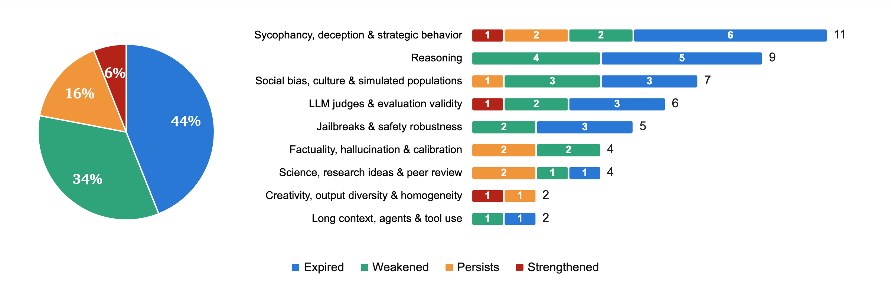
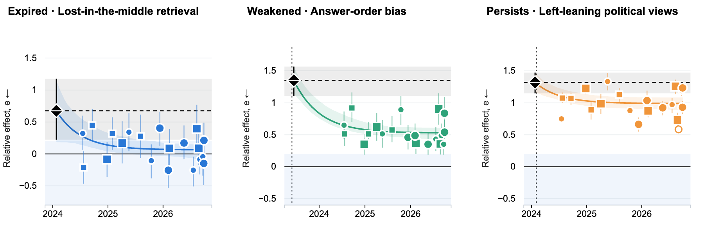

# The shelf life of LLM findings

**How long does a published finding about LLMs remain true?** We revisited 50 widely cited findings about LLMs
across 20 models. Within 15 months of publication, most of the LLM claims we tested either no longer held or showed
substantially diminished effects. What we know about AI may have a surprisingly short shelf life.

**📖 Blog post: <https://zou-group.github.io/llm-claims-shelf-life/>**

**Authors:** [Owen Queen](https://owenqueen.com/) and [James Zou](https://www.james-zou.com/) (Stanford University)

<p align="center">
  <a href="https://zou-group.github.io/llm-claims-shelf-life/"></a>
</p>

## Main findings

| Verdict | Claims | Share | Meaning |
|---|---:|---:|---|
| **Expired** | 22 | 44% | The original effect has largely faded in recent models (fitted effect *e* ≤ 0.2) |
| **Weakened** | 17 | 34% | Still present, but weaker than the paper reported (0.2 < *e* < 0.8) |
| **Persists** | 8 | 16% | About as strong as the paper reported |
| **Strengthened** | 3 | 6% | Stronger than the paper reported |

- **Most findings have faded.** 39 of 50 claims (78%) expired or weakened by September 2026. Many expired
  claims are capability failures, such as miscounting letters, losing facts in the middle of long contexts and
  self-correction hurting reasoning.
- **Expired claims lived about 15 months.** Among the 22 expired claims, the median time from publication to the
  estimated expiration date is 14.7 months. This excludes claims that are still alive, so it is not an expected
  lifespan for all findings. Counting the live claims as censored (Kaplan–Meier), an estimated 16% of claims had
  expired one year after publication and 39% after two years.
- **Some behaviours persist or grow.** Judges preferring their own outputs, praise that follows the user's stated
  preference, and non-uniform "random" numbers are all stronger in recent models than in the original papers.
- **Individual models still differ.** A verdict describes the fitted trend. Some recent models still show expired
  behaviours, and the post's claim cards show each model's value.

Three examples show how findings change across model releases. Losing facts in the middle of a long context has
largely faded; judges' sensitivity to answer order has weakened; left-leaning responses on political orientation
tests persist.

<p align="center">
  
</p>

Each point is a model release. Curves show fitted trends, with shaded 95% intervals; effects are scaled relative
to the original paper. The [interactive post](https://zou-group.github.io/llm-claims-shelf-life/) includes every
claim, its model-level measurements, and the lifespan and strengthened-finding plots.

The selected claims are not a random sample of the literature, and the panel is 20 models chosen for cost and size
coverage. The post's methods and caveats sections give the details.

## Contents

- [Repository layout](#repository-layout)
- [Installation](#installation)
- [Quickstart](#quickstart)
- [Input data](#input-data)
- [Running experiments](#running-experiments)
- [Reproducing the analysis](#reproducing-the-analysis)
- [How the pipeline works](#how-the-pipeline-works)
- [Auditing a claim](#auditing-a-claim)
- [Verification and known limitations](#verification-and-known-limitations)
- [Feedback, citation and licence](#feedback-citation-and-licence)

Reference documents:

| Document | Contents |
|---|---|
| [`claims/CLAIMS.md`](claims/CLAIMS.md) | The 50 claims: blog ID, area, config, variants used and verdict |
| [`code/docs/MODELS.md`](code/docs/MODELS.md) | The 20-model panel, API routes, prices and API keys |
| [`code/docs/RUNNING.md`](code/docs/RUNNING.md) | Run options, output files, regenerating our model outputs, troubleshooting |
| [`code/docs/DATA.md`](code/docs/DATA.md) | Inputs, provenance and licences |
| [`DOWNLOADS.md`](DOWNLOADS.md) | How to download the original papers' code, prompts and data |
| [`code/README.md`](code/README.md) | Package reference: modules and every CLI command |

## Repository layout

The layout mirrors the research workspace the results came from, so every config and provenance record points at
the same relative path it did when the runs were made.

```
llm-claims-shelf-life/
├── claims/                  claim table, all 1,000 panel values, and the run settings behind each value
├── code/                    the `shelflife` package
│   ├── shelflife/           registry, prompts, programs, provider policies, budget ledger, runner, rescoring
│   │   ├── experiments/     one config per claim (cNNN_<slug>.py): prompts, items, scorer, variants
│   │   └── data/sources/    pinned snapshots of the original papers' code, prompts and data (+ PROVENANCE.md)
│   └── tests/               offline tests: core pipeline plus one file per claim
├── experiments/
│   ├── initial-reproduction/          original-repository clones the configs read
│   └── run_minimal_setups/analysis/   per-model values, fits, the post's data (post/) and the scripts (scripts/)
├── docs/                    the website only: index.html is the post and preview.png its link-preview image, served by GitHub Pages
├── data/                    release date and source of each paper behind the 50 claims
├── scripts/                 regenerate_runs.py, install_inputs.py and the input manifest inputs.json
├── assets/                  README figures
└── requirements-analysis.txt   pinned environment for the analysis
```

## Installation

You need Python 3.12 (3.11 or later works for the package), [uv](https://docs.astral.sh/uv/) or pip, and git.

```bash
git clone https://github.com/zou-group/llm-claims-shelf-life.git
cd llm-claims-shelf-life/code

# with uv (recommended)
uv venv .venv --python 3.12
uv pip install --python .venv/bin/python -e '.[test,scoring]'

# or with pip
python3.12 -m venv .venv
.venv/bin/pip install -e '.[test,scoring]'
```

The `scoring` extra installs the original papers' scoring dependencies (spaCy and `en_core_web_sm`, pint, inflect,
pyarrow, eyecite and the legal-citation packages). Without it, the configs that need them fail with an
`ImportError` naming the package. Exact versions are in [`code/requirements-lock.txt`](code/requirements-lock.txt).

## Quickstart

Everything here runs offline and needs no API key.

```bash
cd code
.venv/bin/python -m shelflife.cli list                                   # the 49 registered configs
.venv/bin/python -m shelflife.cli show C043 --variant faireval_vanilla   # prompts with sha256 and source, parameters, deviations
.venv/bin/python -m shelflife.cli plan C043 --variant robust --models M015 M119 M206 --limit 2
                                                                         # exact API payloads and a cost bound
.venv/bin/python -m pytest -q                                            # offline test suite (~2 min)
```

## Input data

Each claim reads the original paper's prompts and data from a pinned snapshot. These files are not in git:
[`scripts/inputs.json`](scripts/inputs.json) lists all 1,428 of them with their origin (a GitHub commit, a Hugging Face
revision or a release archive), size and sha256, and one command fetches and verifies them:

```bash
python scripts/install_inputs.py          # about 576 MB; --check only reports, --claims C7 C10 limits the set
```

[`DOWNLOADS.md`](DOWNLOADS.md) has the details. Files the project prepared from the sources are in git, each with a
`PROVENANCE.md`. Our model outputs are not included;
[`code/docs/RUNNING.md`](code/docs/RUNNING.md#regenerating-our-model-outputs) explains how to regenerate them.

## Running experiments

Only `shelflife.cli run` calls models. It reads `ANTHROPIC_API_KEY`, `OPENAI_API_KEY` or `OPENROUTER_API_KEY`,
depending on the model's route ([`code/docs/MODELS.md`](code/docs/MODELS.md)), and never writes keys to run records,
logs or the ledger. Paid runs go through a budget ledger with a hard spending ceiling.

```bash
cd code
cp ../.env.example ../.env && set -a; source ../.env; set +a      # after filling in your keys

.venv/bin/python -m shelflife.cli plan C043 --variant robust --models M206 --limit 3   # offline: payloads and cost bound
.venv/bin/python -m shelflife.cli run C043 --variant robust --models M206 --limit 3 \
    --run-dir ../runs/C043-robust-M206 --ledger ../runs/ledger.sqlite3 --ceiling 5     # paid; stops at $5
```

For new models, use the `robust` variant, as the post did for its most recent models. Run options, the output
files, per-claim requirements, regenerating our outputs and troubleshooting are in
[`code/docs/RUNNING.md`](code/docs/RUNNING.md).

## Reproducing the analysis

The analysis starts from the per-model values in `experiments/run_minimal_setups/analysis/results_long.csv` and runs
offline:

```bash
python3.12 -m venv .venv-analysis && .venv-analysis/bin/pip install -r requirements-analysis.txt
PY=.venv-analysis/bin/python
A=experiments/run_minimal_setups/analysis/scripts

$PY $A/outliers.py                     # outlier mask                    → analysis/outliers/
$PY $A/fits_anchored.py                # anchored fits + verdicts        → analysis/curves_anchored/
$PY $A/fits_anchored.py --all-points   # sensitivity: keep outliers      → analysis/curves_anchored_all_models/
$PY $A/fits_anchored.py --classes      # open/closed, small/large fits   → analysis/curves_anchored/class_fits.json
$PY $A/post_data.py                    # everything the post displays    → analysis/post/{results,numbers}.json
$PY $A/lifespan.py                     # Kaplan–Meier lifespans          → analysis/lifespan/
git status --short                     # the scripts overwrite the shipped outputs in place; no diff = reproduced
```

To refit one claim, run `$PY $A/fits_anchored.py --claim=C043`. Seeds are fixed and versions are pinned. The per-model
values in `analysis/results_long.csv` are the starting point; the step that extracted them from our saved model
outputs is not included. The post
([`docs/index.html`](docs/index.html), one self-contained file) embeds `analysis/post/results.json` and draws its
figures from it.

## How the pipeline works

`shelflife` is a registry-driven pipeline. Each claim is one module, `code/shelflife/experiments/cNNN_<slug>.py`,
whose docstring states the claim, the paper version, where every prompt and dataset came from, and how refusals,
parse failures and truncation count. The module defines:

- **variants**: named protocols with prompts, request parameters and repeats, marked `faithful` or listing their
  `deviations` from the paper;
- **items, program, score and aggregate**: the test items, how the model is called (single turn, dialogue, judge or
  agent), the paper's scorer where one was released, and the headline metric with its CI;
- **`PaperTarget`s**: the paper's numbers recomputed offline from the authors' released outputs;
- **`PriorRun`s**: earlier runs whose requests the current code must reproduce byte for byte.

Every prompt records the repository, file and locator it was copied from. Where possible, configs call the authors'
own prompt builders and scorers instead of reimplementing them. Each claim was run with the paper's protocol (or the
smallest design that measures the paper's effect at panel scale), plus a `robust` variant for modern models that
runs the paper's parser first and a conservative fallback only when it finds nothing. The claim tests check that robust scores equal paper scores
wherever the paper's parser succeeds.

From per-model values to verdicts: each value is normalised to an effect `e = (value − null) / (paper − null)`
(`e = 1` is the paper's effect, `e = 0` none). A curve anchored at our reproduction on the paper's model is fitted to
the panel models released after it. A claim is **expired** when its fitted curve reaches `e ≤ 0.2` and stays there through
September 2026 (20 of the 22 expired claims), or when at least four of the 8 panel models released in the last six
months have `e ≤ 0.2` (point estimates, outliers included; this adds C22 and C50, whose curves end just above 0.2).
Otherwise the fitted curve on 2026-09-30 and its bootstrap interval decide: **persists** if `e ≥ 0.8` with the
interval's lower bound above 0.2, **strengthened** if `e ≥ 1.5` or the whole interval is above 1 and rising, and
**weakened** in between.

## Auditing a claim

[`claims/CLAIMS.md`](claims/CLAIMS.md) maps the post's IDs (C1–C50) to configs. For example, for C4 (`C043`):

1. Read `code/shelflife/experiments/c043_faireval.py`; run `shelflife.cli show C043 --variant <v>` for the exact
   prompts and sources and `shelflife.cli plan` for the exact payloads.
2. Run `pytest tests/claims/test_c043.py`: it recomputes the paper's numbers from released data, checks the scorer
   against the original and checks robust/paper parser agreement.
3. See the rows with `blog_id == C4` in [`claims/panel_values.csv`](claims/panel_values.csv) and the fit in
   `experiments/run_minimal_setups/analysis/curves_anchored/fits.json`.


## Verification and known limitations

Checks run on this release (macOS, Python 3.12, fresh environment):

| Check | Result |
|---|---|
| `pytest -q`, no API keys set | 2,529 passed, 393 skipped, 5 expected failures, 0 failures |
| `install_inputs.py --check` | 1,428/1,428 files present, sha256 verified |
| `shelflife.cli list` / `show` / `plan` | 49 configs; prompts and payloads render offline |
| `fits_anchored.py --claim=…` and `lifespan.py` | Reproduce the shipped outputs |
| `post_data.py` | Regenerates `analysis/post/`; the shipped copy is the one the post embeds |
| `shelflife.cli run` with no key | Fails cleanly: HTTP 401 recorded, $0 charged, no credential in the records |

The skipped tests need the upstream git clones or optional scoring packages. We did not rerun any paid experiments for this
release.

- **Saved model outputs are not included** (about 14 GB). The analysis starts from the per-model
  values in `analysis/results_long.csv`. C041's judge step (`gpt4_judge_full`) grades saved GPT-4 outputs, so it cannot build its items.
- **Only what the post shows.** Each config keeps the variants that produced a value in the post, the variants they
  derive from, and its default.
- **Deliberately blocked variants.** C013 `paper_original_blocked` and C051 `paper_original` raise an error, because
  the original data was never released; their configs use labelled reconstructions.
- **Paper-model substitutes.** Several paper models are retired, so some reproductions use the nearest surviving
  snapshot (`repro_model` in [`claims/claims.csv`](claims/claims.csv)).

## Feedback, citation and licence

Please open an issue. The most useful reports name the claim ID (C1–C50), the file and line, and what you expected
instead. We are especially interested in prompt or scorer differences from the original papers, parsing rules that
could favour one model family, and choices in the fitting and categorisation.

The code is released under the [MIT licence](LICENSE). Third-party material under `code/shelflife/data/sources/` and
`experiments/initial-reproduction/` keeps its original licence; see each directory's `LICENSE` and `PROVENANCE.md`
and [`code/docs/DATA.md`](code/docs/DATA.md). Paper figures shown in the post are credited to their sources on the page.

If you use this work, please cite:

```bibtex
@misc{queen2026shelflife,
  title  = {The shelf life of {LLM} findings},
  author = {Queen, Owen and Zou, James},
  year   = {2026},
  url    = {https://zou-group.github.io/llm-claims-shelf-life/}
}
```
